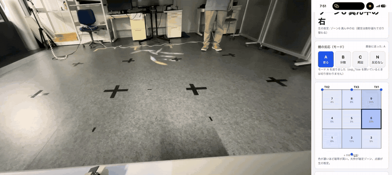
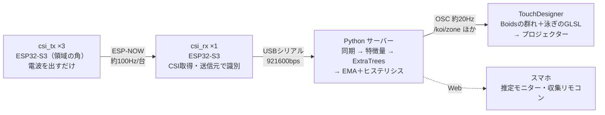

# Wi-Fiの電波で人の位置を当てて、鯉が寄ってくるプロジェクションマッピング

カメラを使わずに、**ESP32-S3 の Wi-Fi CSI（Channel State Information）** から人がどのゾーンにいるかを機械学習で推定し、
TouchDesigner で床（将来は浴槽の水面）に投影した鯉の群れをその場所へ寄ってこさせるインタラクティブ作品です。



*左：斜め上から撮った投影面（3m×3m）。右：スマホで見ている推定モニター（太枠が確定ゾーン、色の濃さが確率）。
人が右奥から右中央へ移動すると、確定ゾーンが 9 → 6 に切り替わり、鯉の群れが追いかけてくる。*

| | |
| --- | --- |
| 種別 | 個人開発（ハードウェア・機械学習・映像演出まですべて一人で実装） |
| 期間 | 2026年7月〜（継続中） |
| 主な技術 | ESP32-S3 / ESP-IDF (C), Python, scikit-learn, OSC, TouchDesigner, GLSL, Blender |

---

## なぜ作ったか

浴室のようなプライベートな空間では、人の動きに反応する演出をしたくても**カメラは置けません**。
そこで、Wi-Fi の電波が人の体で遮られたり反射したりして変わる様子（CSI）だけを使って、
「浴槽のどこに人がいるか」を当てることにしました。映像はとらないので、プライバシーを守ったままインタラクションを作れます。

いまは室内の床に 3m×3m の領域を作り、浴槽の代わりにして試作しています。

## システム構成



- 領域を 1m 角の 3×3 = **9ゾーン＋「誰もいない」の10クラス**に分けて分類します。
- PC につなぐのは受信機 1台だけ（USB 1本）。送信機は電源さえあればよく、PC の Wi-Fi 設定も要りません。

| 部分 | 中身 | 場所 |
| --- | --- | --- |
| ファームウェア | 送信機（ESP-NOW で定期送信）／受信機（CSI を取り出しシリアルへ） | [`firmware/`](firmware/) |
| 受信・同期 | シリアルのフレーム化・CRC 確認・複数 TX の時刻合わせ | [`server/csi_receiver/`](server/csi_receiver/) |
| 特徴量・モデル | 振幅の正規化、1秒窓の統計量、ExtraTrees / RandomForest / kNN | [`server/features/`](server/features/), [`server/models/`](server/models/) |
| 収集・学習・評価 | 音声ガイド付きの自動収集、周単位の交差検証、学習曲線 | [`server/collection/`](server/collection/), [`server/training/`](server/training/) |
| リアルタイム推定 | 確率の平滑化・ゾーン確定・OSC 送信・スマホ用モニター | [`server/localization/`](server/localization/), [`server/web/`](server/web/) |
| 映像演出 | 鯉の群れ（Boids）、人への反応 4パターン、泳ぎの頂点シェーダー | [`touchdesigner/`](touchdesigner/) |
| 鯉のCG | Blender でポリゴン削減・テクスチャ焼き込みをするスクリプト | [`assets/koi_model/`](assets/koi_model/) |

## 工夫したこと・判断したこと

### 1. 座標の回帰をやめて「ゾーン分類」にした

ESP32 で取れる CSI は振幅だけで分解能が粗く、連続した座標を当てるのは難しいとわかりました。
演出で必要なのは「鯉がだいたいその辺りに寄ってくること」なので、**目的に対して十分な粒度**として 9ゾーンの分類に切り替え、
評価指標（応答の速さ、境界でぶれないこと）もゾーン単位で決め直しました。

### 2. 機器構成を作り直して、設営と同期の問題をなくした

最初は「AP 1台＋受信機複数台＋UDP で PC へ」という構成でしたが、PC の Wi-Fi 接続や IP 設定が必要で、
受信機ごとに時計が違うため同期も面倒でした。そこで **送信機複数台 → 受信機 1台（USB）** に構成を変えました。
送信機は起動時に MAC アドレスを `02:C5:15:00:00:<ID>` に書き換えるので、受信機は送信元の MAC だけで送信機を見分けられ、近くの他の機器の電波も自動で除外できます
（[設計メモ](docs/design_tx_rx.md)）。

### 3. 境界で鯉がうろうろしないように、確率を平滑化してから確定する

推定結果をそのまま使うと、ゾーンの境目で判定が毎フレーム入れ替わり、鯉が行ったり来たりしてしまいます。
確率に EMA をかけたうえで、直近約1秒の多数決でゾーンを切り替えるヒステリシスを入れました。
確定ゾーンとは別に確率そのものも OSC で送っているので、演出側で「迷っている」表現にも使えます（[プロトコル仕様](docs/protocol.md)）。

### 4. 評価が甘くならないようにした（そして、甘かったことに気づいた）

同じ記録の中のフレームを学習とテストに分けると、ほぼ同じデータで答え合わせをすることになり、正解率が高く出すぎます。
そこで収集を「周」に分け、**ある周を丸ごとテストに回す交差検証**にしました。
さらにリアルタイムで動かした結果と比べ、それでもまだ評価が甘いことを数値で確かめました（下の「結果と課題」）。

### 5. 実機がなくても全体を試せるようにした

仮想センサー（[`server/tools/simulate.py`](server/tools/simulate.py)）と手動 OSC 送信ツールを作り、
ESP32 がなくても「収集 → 学習 → 推定 → TouchDesigner」の流れを確認できるようにしました。
データ収集はスマホの画面と音声ガイドで一人でも回せます。

## 結果と課題

実機で 3日間データを集め、センサーの配置やモデルを比べました（記録の全文は [docs/results.md](docs/results.md)）。

| 条件 | モデル | 正解率 | macro-F1 |
| --- | --- | --- | --- |
| 4つ角に配置（8周） | **ExtraTrees** | **0.831** | **0.822** |
| 扇形に配置（6周） | ExtraTrees | 0.731 | 0.704 |
| 扇形に配置（6周） | RandomForest | 0.660 | 0.621 |
| 扇形に配置（6周） | kNN | 0.511 | 0.473 |

*周単位の交差検証、10クラス（偶然当たる確率は 0.1）。*

一方、**リアルタイムで動かすと、この評価ほどは当たりませんでした**。
一番高い確率の中央値は評価時の 0.40 に対して 0.28 で、人がいない時間があったのに「誰もいない」を一度も出しませんでした。
原因を調べると、**同じゾーンに立ち直すだけで、隣のゾーンへ移ったときと同じくらい電波が変わる**ことがわかりました。
今の特徴量では、ゾーンの違いが「立つたびの違い」に埋もれています。

今後は、正解ラベル付きのテスト用データで実際の当たり方を測ったうえで、ゾーンの数と大きさ（例：左右だけ、いる／いないだけ）と特徴量を見直す予定です。

## 動かし方

ESP32 がなくても、仮想センサーでパイプライン全体を試せます。

```bash
cd server
python -m venv .venv
.venv/Scripts/pip install -r requirements.txt
```

その後の手順（仮想センサー・収集・学習・推定のコマンド）は [server/README.md](server/README.md) にあります。
実機での手順は [docs/runbook.md](docs/runbook.md)、TouchDesigner 側は [touchdesigner/README.md](touchdesigner/README.md) を見てください。

## ドキュメント

- [docs/design_tx_rx.md](docs/design_tx_rx.md) — 機器構成の設計と、方式を選んだ理由
- [docs/protocol.md](docs/protocol.md) — シリアル・OSC の通信仕様
- [docs/calibration.md](docs/calibration.md) — データ収集（キャリブレーション）の考え方
- [docs/results.md](docs/results.md) — 実験結果と考察（日付順）
- [docs/runbook.md](docs/runbook.md) — 実機で実際に行った手順とコマンドの記録

## ライセンス

All rights reserved. このリポジトリは**閲覧のみ**を目的として公開しています。
コード・3Dモデル（自作）・画像などの複製・改変・再配布・利用はできません。詳しくは [LICENSE](LICENSE) を見てください。
